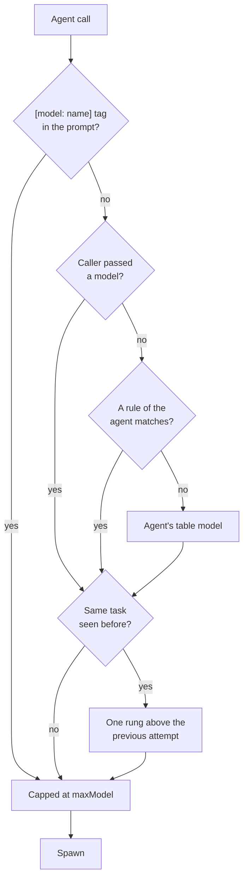

<div align="center">

# 🧭 agent-model-router

**The right model for every subagent. Cheap by default, stronger on retry.**

A Claude Code plugin that picks the model each subagent runs on, per project, and learns from what it picked.

[](https://github.com/deki-lab/agent-model-router/actions/workflows/check.yml)


[Quick start](#-quick-start) · [How it works](#-how-it-works) · [Configuration](#%EF%B8%8F-configuration) · [Retries](#-how-a-retry-is-recognized) · [Tuning](#-tuning-the-table)

</div>

---

## Why

Your writer drafts on `sonnet`. Your explorer greps on `haiku`. Your architect thinks on `opus`. And when a draft fails review, the second attempt should not run on the same model that just failed.

agent-model-router does exactly that, with one JSON file per project:

| | |
|---|---|
| 📋 **A table per project** | Each agent gets a model, plus optional rules that match the task text. |
| 🪜 **Steps up on retry** | The same task sent to the same agent again runs one model higher: `haiku` → `sonnet` → `opus`. A retry usually means the first attempt failed review. |
| 📓 **Logs every choice** | Each decision goes to a local journal. The bundled `model-tuner` agent reads it and proposes changes backed by numbers. |
| 💰 **A cost cap** | `maxModel` caps every choice. |
| 🛟 **Never in the way** | The plugin never blocks an agent. With no config, or a broken one, agents run exactly as they would without it. |

## 🚀 Quick start

**1. Install**, in a Claude Code session:

```
/plugin marketplace add deki-lab/agent-model-router
/plugin install agent-model-router@agent-model-router
```

Pick a scope when asked. The plugin is active right away. From a shell: `claude plugin marketplace add deki-lab/agent-model-router`, then `claude plugin install agent-model-router@agent-model-router`.

**2. Set up a project**, from inside it:

```
/model-router
```

**3. Work as usual.** Toasts show each time the plugin changes a model, for example `writer → opus (escalation, attempt 2, previous sonnet)`.

> Requires Claude Code 2.1.293 or later (function hooks).

## 🎯 Who it is for

The plugin acts only when Claude delegates work to a **subagent** (the Agent tool). It never changes the main conversation's model.

It pays off in projects that delegate repeated tasks to agents: a writer, a reviewer, a researcher. The agents can be the project's own, in `.claude/agents/`, or installed for the user or by a plugin (`~/.claude/agents/`, a team such as `dev-team:kody`).

| Your project | What the plugin does |
|---|---|
| ✅ Agents of its own, of the user's or of a plugin, delegated to often | Everything this README describes |
| 🟡 No agents of its own | Routes only the built-in agents Claude spawns by itself (`Explore` on `haiku` by default). Little to gain |
| ⛔ No delegation at all | Nothing. Its only cost is the `model-tuner` agent's description, about 80 tokens per session. Leave it uninstalled |

## 🔧 Set up a project

`/model-router` is one command, run as often as you like. The first time, it does two things, with nothing to edit by hand:

1. **Writes `.claude/agent-model-router.json`** from your project: one entry per agent in `.claude/agents/`, on the model its frontmatter names, plus `Explore` on `haiku`. An agent whose model is not on the ladder (`fable`, `inherit`) keeps its own model: the table never moves it. Routing is on from here, with a working config.
2. **Asks Claude to fit it to the project**, in a turn of its own right after the command. Claude:
   - reads your agents and `CLAUDE.md`;
   - adds the user and plugin agents the project delegates to (`dev-team:kody`), keyed by their full name, and leaves out the plugin agents this project does not use;
   - sets `escalation.taskKey` to the way your tasks are named, in their language (`bloc 3`, `ticket 42`);
   - adds rules only where the project marks a kind of task as harder;
   - points `context` at the files where outcomes are recorded;
   - proposes one line for your `CLAUDE.md` so that each delegation names its task (see [How a retry is recognized](#-how-a-retry-is-recognized)), and asks before writing it.

   When the project delegates to no agent at all, Claude changes nothing and says so.

Each later run shows the active config, then fits it again to the project as it is now (a new agent, a renamed task). It never overwrites the config: Claude edits it, with your permission.

| Command | What it does |
|---|---|
| `/model-router` | Creates the config if there is none, shows it, then has Claude fit it to the project |
| `/model-router status` | Only shows the config, the retry history and the last decisions. No model turn |
| `/model-router fable on` | Puts `fable` on top of the ladder and makes it the cap, after checking your account can use it. See [Using fable](#-using-fable) |
| `/model-router fable off` | Takes `fable` off the ladder and the cap |

Claude Code asks your permission before Claude edits a file under `.claude/`; accept it to let the fitting apply. In a headless `claude -p` run nobody can accept, so Claude only reports the changes it proposes: run `/model-router` later in an interactive session.

## 🧠 How it works

On every spawn, the plugin decides in this order:



1. A `[model: <name>]` tag in the prompt. Tags are never escalated.
2. The `model` the caller passed to the Agent tool.
3. The agent's first matching rule.
4. The agent's table model.
5. Retry: if the same task was spawned before, one rung above the model the previous attempt ran on, when that is higher.
6. `maxModel` caps the result.

If the spawn is refused on the chosen model (for example a model your account does not have), the agent runs on the model it would have used without the plugin, and a toast says so. The default ladder stops at `opus`, so escalation never picks a model you did not list.

Forks always inherit their parent's model, and workflow agents cannot be rewritten: the plugin leaves both alone.

## ⚙️ Configuration

`.claude/agent-model-router.json`, read on every spawn, so edits apply immediately:

```json
{
  "ladder": ["haiku", "sonnet", "opus"],
  "maxModel": "opus",
  "agents": {
    "Explore": { "model": "haiku" },
    "writer": {
      "model": "sonnet",
      "rules": [{ "match": "\\b(intro|hook)\\b", "model": "opus" }]
    },
    "*": { "model": "sonnet" }
  },
  "escalation": { "enabled": true, "taskKey": "(?:task|step)\\s*#?\\d+", "windowMinutes": 240 },
  "journal": { "enabled": true, "path": ".claude/agent-model-router/journal.jsonl", "maxEntries": 1000 },
  "tags": true,
  "notify": true,
  "context": ["docs/reviews/*.md"]
}
```

<details>
<summary><b>All fields</b></summary>

| Field | Meaning | Default |
|---|---|---|
| `enabled` | Turns routing off without removing the file | `true` |
| `ladder` | Models from cheapest to most capable. Aliases or full ids; a full id matches the alias it contains | `["haiku", "sonnet", "opus"]` |
| `maxModel` | Highest model the plugin may choose. Must be on `ladder`. A model off the ladder (a tag such as `[model: fable]` under the default ladder) is capped too | none |
| `agents.<name>.model` | Model for that agent. Omit it to keep the agent's own frontmatter model | agent default |
| `agents.<name>.rules` | `{ match, model }` list. `match` is a case-insensitive regular expression tested on the task description and prompt; the first match wins | `[]` |
| `agents["*"]` | Entry for agents not listed | none |
| `escalation.taskKey` | Regular expression that identifies "the same task" in the description or prompt. Without it, the task description is the key | none |
| `escalation.windowMinutes` | How long a task is remembered for retry detection | `240` |
| `journal.maxEntries` | Lines kept in the journal; the oldest go first. The whole file is rewritten on each spawn (the plugin API has no append), so keep it modest. 1000 lines is about 250 KB and plenty for the tuner | `1000` |
| `journal.path` | Where decisions are logged: a relative path under `.claude/`, no `..`. Any other value turns routing off, and the plugin never writes through a symbolic link that leads outside the project | `.claude/agent-model-router/journal.jsonl` |
| `tags` | Honour `[model: <name>]` written in a delegation prompt | `true` |
| `notify` | Show a toast when the plugin changes a model | `true` |
| `context` | Files or globs the `model-tuner` agent reads to learn which tasks passed or failed | `[]` |

Agent names match the spawned type exactly (`agent-model-router:model-tuner`) or by its last segment (`model-tuner`).

</details>

## ✨ Using fable

`fable` is the most capable model, and the most expensive. It is **off by default**: the default ladder stops at `opus`, so the plugin never picks a model your account may not have.

Turn it on per project:

```
/model-router fable on
```

The command first sends `fable` a one-line question. If your account cannot use it, the command says so and leaves the config unchanged. Otherwise it edits two fields and keeps the rest as written:

```json
"ladder": ["haiku", "sonnet", "opus", "fable"],
"maxModel": "fable"
```

What changes:

- A retry of a task that ran on `opus` now runs on `fable`.
- A table model, rule or `[model: fable]` tag can now pick `fable`. Before, `maxModel: "opus"` capped them to `opus`.

To use `fable` only where you ask for it, never through retries, keep it on and turn retries off (`"escalation": { "enabled": false }`), or give the agents that need it a rule or a table model of `fable`.

Turn it off with `/model-router fable off`: `fable` leaves the ladder and the cap falls back to `opus`. The fitting that `/model-router` runs never touches `ladder` or `maxModel`, so your choice stays.

## 🔁 How a retry is recognized

### The idea

When a subagent's work fails review, Claude usually sends the same task to the same agent again. The plugin treats that second send as a sign the model was too weak, and runs it one model higher.

To do that, it must recognize "the same task". Example, in a project that writes a video script block by block:

| Step | Request | Model |
|---|---|---|
| 1 | Claude asks `writer` for **block 3** | `sonnet` |
| 2 | The review rejects it. Claude asks `writer` for **block 3** again | `opus` ⬆️ |
| 3 | Claude asks `writer` for **block 4**. New task | `sonnet` |

### How the plugin names a task

Each time Claude delegates, it fills two fields of the Agent tool. You never write them yourself:

| Field | What it holds | Example |
|---|---|---|
| `description` | A short title, a few words | `Episode 2 block 3` |
| `prompt` | The full instructions, often with context such as the tasks already done | `Block 1 and block 2 are approved. Write block 3 ...` |

The plugin turns each delegation into a task name:

- If the config has `escalation.taskKey` (a pattern such as `block\\s*\\d+`), the task name is the first text that matches it, looked for in the `description` first, then in the `prompt`.
- Otherwise, or when nothing matches, the task name is the whole `description`.

The same agent receiving the same task name again within `windowMinutes` (4 hours by default) is a retry.

### Why the description matters

The pattern is looked for in the `description` first. When the description names the task, the result is right. When it does not, the plugin falls back on the `prompt`, which often mentions other tasks first.

With `"taskKey": "block\\s*\\d+"`, asking `writer` for block 3:

| `description` Claude wrote | Task name | Outcome |
|---|---|---|
| `Episode 2 block 3` | `block 3` | ✅ Right |
| `Write narration` (the prompt starts with "Block 1 and block 2 are approved") | `block 1` | ❌ Wrong task: a real retry of block 3 is missed, and a later request about block 1 is taken for a retry |
| `Write narration` (no block number in the prompt) | `write narration` | ❌ Every request to `writer` has the same name: each one after the first is taken for a retry |

So Claude must name the task in the `description`. You do not have to do it by hand: `/model-router` proposes a line for your `CLAUDE.md`, such as

> The `description` of each Agent call names the task and its scope, for example `Episode 2 block 3`.

and adds it once you accept.

### Check it

Each line of `.claude/agent-model-router/journal.jsonl` has a `task` field: the agent and the task name. After a few delegations, read it. Each distinct task should have its own name, and a retry should show `"attempt": 2`.

### Pitfalls

- **The same task name in two places.** `block 3` of episode 1 and `block 3` of episode 2 get the same name. If you work on both within 4 hours, the second looks like a retry. Either lower `windowMinutes`, or put the episode in the pattern and in the descriptions: `"taskKey": "episode\\s*\\d+\\s*block\\s*\\d+"` with descriptions such as `Episode 2 block 3`.
- **Rules see the whole prompt.** This one is about `rules`, not retries: a rule is tested on the description and the prompt together. A word that sits in the repeated context, such as `intro` in a list of approved blocks, triggers the rule on every request. Match a phrase that only appears in the request itself, such as `write the intro`.
- **Accented letters.** In these patterns, `\b` (word boundary) only knows the letters a to z. `\bécris` never matches. Do not put `\b` next to an accented letter.

## 📈 Tuning the table

After a batch of work, ask Claude:

> Run the model-tuner agent.

`model-tuner` reads the config, the journal, the files listed in `context` and your agents' frontmatter. It reports first-attempt success per agent and model, and proposes minimal config changes with the numbers behind them. It proposes only; you edit the config. Below about 20 journal entries it answers "not enough data".

## 🔒 Privacy

The journal stores task descriptions, agent names and models, never prompts. Its folder gets a `.gitignore` containing `*` on first write, so it stays out of git unless you remove that file.

## ⚠️ Limits

- Retry detection is a proxy for failure. A task re-sent for another reason (new scope) also escalates. Set `taskKey` so distinct tasks get distinct keys.
- Rules match the prompt as Claude Code passes it to the subagent, which can include text added by the engine. Keep patterns specific.
- Retry history lives in the plugin's store across sessions, keyed by project root and pruned after `windowMinutes`.
- Patterns (`rules[].match`, `escalation.taskKey`) are capped at 300 characters, and a pattern that repeats a group which itself repeats or has alternatives (`(a+)+`, `(a|b)*`) is refused: on a long prompt such a pattern can take forever to match. Patterns are tested on the first 20,000 characters of the description and prompt.
- The plugin never reads or writes its config or journal through a symbolic link that leads outside the project: such a config turns routing off.

## 🛠️ Development

```
claude plugin validate .
claude plugin test .
claude --plugin-dir .
```

See [CHANGELOG.md](CHANGELOG.md) for what changed in each version.

## License

[MIT](LICENSE)
